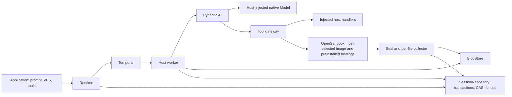
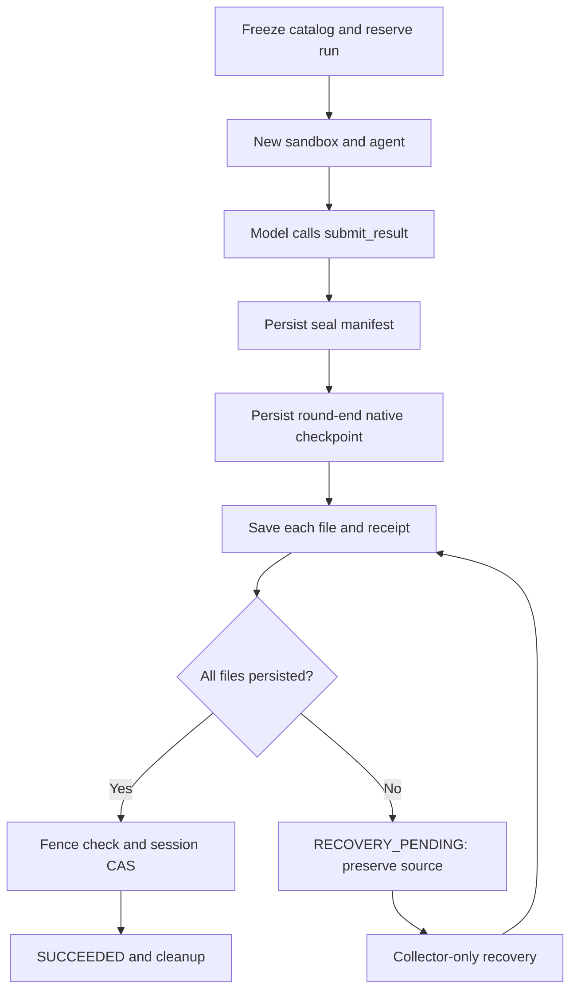

# Foliorun

Foliorun executes document tasks from **a prompt, your read-only VFS, and your
tools**. It persists explicitly submitted files and round-end session checkpoints.
The agent and credentials stay on the host; preinstalled document tools run in
disposable sandboxes.

The production adapters are **Pydantic AI + Temporal + OpenSandbox**.

## Architecture



Default storage is private local FS plus SQLite FULL/WAL. Storage protocols also
accept caller-owned implementations. No external database or `WorkspacePool`
is required. The application owns authorization and deployment; a `scope` is
not an authentication mechanism.

Foliorun standardizes execution, tool and file boundaries, collection, and
session save/restore interfaces. Harnesses own their native configuration and
checkpoint formats; a checkpoint does not translate between Harnesses. The
core install does not include any Harness or provider SDK.

## Install And Run Offline

Python **>=3.12,<3.14**:

```sh
python -m pip install .
python examples/offline.py
python examples/custom_storage.py
```

These examples use only core dependencies. The first freezes metadata, reads
one file on demand, verifies it and downloads a local copy. The second injects
a synthetic object client with a selected bucket/prefix and a local index.
Both use temporary directories and require no credentials or network.

For a complete two-round execution using the real Pydantic Harness with a
`FunctionModel` and explicitly synthetic sandbox/scheduler transports:

```sh
python -m pip install ".[pydantic-ai]"
python examples/offline_injection.py
python examples/offline_exec.py
python examples/offline_session.py
```

Expected output:

```text
offline session: 2 revisions, 2 fresh sandboxes, original input and native history
```

The injection example runs two fictional model/image pairs through the same
Runtime and checks submission and collection for both. It uses a synthetic
sandbox; SDK request serialization is covered separately by offline tests.
The execution example binds an explicit sandbox entrypoint, creates an output
through that tool, and verifies the collected bytes.
The synthetic transports are examples, not supported production adapters.
The installed wheel contains Python code; examples, Skills and image sources
are in the checkout/sdist.

## Three Inputs

Inside an assembled runtime, with workers running:

```python
from foliorun import MemoryFS

handle = await runtime.submit(
    prompt="Revise the fictional document and submit the result.",
    vfs=MemoryFS({"/documents/specimen.txt": b"Entirely fictional specimen"}),
    tools=tools,
    idempotency_key="fictional-round-1",
    session_id="fictional-session",
)
result = await runtime.wait(handle, timeout=600)
if result.status == "SUCCEEDED":
    await runtime.artifacts.download_to(
        result.artifacts[0],
        destination_path,
    )
```

`runtime.run(...)` combines submit and wait. `get(handle)` polls.
`WaitTimeout` carries the handle and does not cancel execution.
`await runtime.cancel(handle)` records a publication fence; it does not claim
remote code has stopped immediately.

### Your VFS

Implement `freeze`, `list`, `stat`, `open_read` from
[`VirtualFS`](src/foliorun/vfs.py). `freeze()` supplies a fixed revision and
entries with path, size and SHA-256. It must not describe an arbitrary mutable
directory as a stable snapshot.

Submission freezes the **catalog only**, not every file body. Listing,
stat and Skill discovery read metadata. `read_file` or `materialize_files`
fetches and verifies only selected files. Sandbox tool parameters named in
`ToolSpec.input_paths` automatically materialize those files at their original
paths. This is explicit materialization, not a transparent filesystem mount.

Input roots: `/documents`, `/materials`, `/inputs`, `/skills`. Inputs and
`/previous` are read-only; tools may write `/workspace` and `/output`.
`list_files` lists frozen inputs and previous submitted files. `stat_file`
returns size and SHA-256 for a known input, previous file or current `/output`
file. `read_file` reads UTF-8 text from those same paths, using Unicode character
offsets and bounded JSON pages. Follow `next_offset` until `eof` is true.
Current outputs are read inside this run's sandbox; input text comes from the
verified VFS. Workspace files, other runs, links and arbitrary host paths are
not readable through these interfaces. Output inspection does not seal or submit.
Skill catalogs carry name/description; full Skill text is read on demand.

`MemoryFS` already holds bytes in memory. `FilesFS` captures caller-owned local
exports and computes their hashes at construction, with symlink/change checks.
That local capture is intentionally eager; framework freeze and sandbox prepare
are not. For large remote inputs, implement a retained revision provider with
already known hashes instead.

Access expiry is separate `AccessLease` metadata. Refreshing a lease or signed
URL must preserve the provider binding, revision and catalog. URLs, tokens and
clients stay inside the host provider; never put them in entries or bindings.
Changing only expiry does not change the job fingerprint or run handle.

A later worker must reinstall retained providers using
`bindings.install_vfs(provider_ref, provider)` and reopen the same store/scope.
Files already read are verified and archived as blobs; unread files still need
their retained provider. Missing providers or expired leases fail explicitly.
`MemoryFS` is not a durable cross-process source by itself.

### Your Tools

`Tools` is a small injected container (`ToolRegistry` is its compatibility
name), not a capability registry service. Supply closed JSON schemas and
handlers:

```python
from foliorun import Tools, ToolSpec

tools = Tools(release="fictional-lookups-1")


async def lookup(args, ctx):
    ctx.check_cancelled()
    return {"kind": "json", "value": {"id": args["id"]}}


tools.register(
    ToolSpec(
        name="lookup",
        description="Read a fictional record.",
        execution_location="host",
        effect="read_only",
        input_schema={
            "type": "object",
            "properties": {"id": {"type": "string"}},
            "required": ["id"],
            "additionalProperties": False,
        },
    ),
    lookup,
)
bindings.install_tools(tools)
```

Also include the tool name in `profile.allowed_tools`. Definitions seal on
installation so mutable schemas cannot silently change recovery identity.
Change the release identity when changing a handler implementation.

For sandbox routing, use `SandboxCommand(entrypoint="your-binding")` and inject
the corresponding `PreinstalledTool(argv=(...))` into
`OpenSandboxProvider(tools={...})`. The provider actually selects this fixed
argv; the model supplies only schema-validated arguments, never executable
paths or commands. See [`examples/bindings.py`](examples/bindings.py) for DOCX.
Its optional `source` parameter is explicitly bound through `input_paths`.
Tools must be foreground, synchronous preinstalled programs with no background
writers. Supply a trusted `seal_argv` implementing the adapter's output seal
contract. The example image includes such a sealer; the adapter has no default
tool or sealer command.

External-effect handlers require their own idempotency implementation or
explicit repeat permission before whole-round fallback. Declaring
`retry_class="idempotency_required"` is a host assertion, not an exactly-once
service. Unknown side effects are never automatically retried.

## Submission And Collection



The model must explicitly call `submit_result` with actual `/output/...` paths.
Text claiming success is not a file result. Success requires every file receipt,
the native checkpoint and the session head transaction. Partial receipts are
not downloadable committed artifacts.

Recovery is a trusted worker operation, not another model run:

```python
state = runtime.collection(handle)
await executor.recover_collection(
    handle.run_id,
    state["seal_ref"]["sha256"],
)
await scheduler.collection_recovered(handle)  # Wake a waiting Temporal workflow.
```

The recovery worker needs storage and the original provider, not a Harness.
Previously saved files are verified and skipped. Sources remain until the
persisted deadline; the OpenSandbox service expiration is checked at creation.
If service TTL cannot cover the window, creation fails. Missing/expired sources
become `NEEDS_REVIEW/output_source_lost`, never an implicit model rerun.

Use `await executor.expire_collections()` as explicit maintenance and
`await executor.cleanup(run_id)` for eligible cleanup compensation.
`cleanup="pending"` is not proof of deletion. Unknown seal outcomes or a
missing native checkpoint require review, not normal successful recovery.

## Continue A Session

Every successful revision references the submitted input, effective input,
native checkpoint, committed outputs, bindings and parent manifest.

```python
version = result.session_version
followup = await runtime.run(
    prompt="Revise the fictional result under /previous and submit it.",
    vfs=MemoryFS({}),  # Empty delta inherits inputs; it does not delete them.
    tools=tools,
    idempotency_key="fictional-round-2",
    session_id=version.session_id,
    session_revision=version.revision,
)
```

A fresh sandbox sees inherited input paths in its catalog, with on-demand
materialization at those original paths. The immediately previous committed
outputs map to `/previous`. Native messages restore with fresh tool closures.
Unsubmitted outputs and temporary workspace files do not return.

Changing an inherited path requires
`overrides={"/documents/x": expected_old_sha256}`. Deletion requires
`tombstones={"/documents/x": expected_old_sha256}` with no incoming file at that
path. `input_mode="replace"` explicitly replaces the input set.

`runtime.session_versions(id)` reads revisions;
`await runtime.checkpoint(handle)` returns an already successful revision.
`runtime.sessions.create/get/close/delete` are synchronous metadata operations.
Close/delete reject active or review sessions. Session deletion does not remove
independent artifact receipts.

Native restore failure may explicitly fall back to a whole new attempt:
configure `FallbackPolicy(max_attempts=1)` in the profile, default **0**.
The same session gets a **new run_id**, a durable `attempt_of` relationship,
the last successful input/output snapshot, and fresh native history. The prompt
and explicit input delta still apply. No half-produced files are reused.
`Runtime.get/wait` follows the attempt relationship and returns the final attempt
handle. Cancellation follows the same relationship. Model/tool unknown windows,
binding changes and collection failures do not trigger this fallback.

Only round-end checkpoints are supported: no arbitrary mid-run lossless resume,
cross-Harness migration or exactly-once promise.

## Storage Injection

```python
from foliorun import LocalSessionRepository, S3BlobStore, Storage

store = Storage(
    blobs=S3BlobStore(
        client=your_existing_client,
        bucket="your-bucket",
        prefix="your-prefix",
        scope=authorized_scope,
    ),
    sessions=LocalSessionRepository(private_index_path, authorized_scope),
)
```

Or inject your own `BlobStore` and `SessionRepository`. No S3 SDK is mandatory.
The S3 adapter uses the caller's synchronous client with conditional immutable
writes and read-back; it does not create buckets or change lifecycle policies.

The index must provide real serializable transactions spanning CAS, scans,
session/run publication, leases and cancellation. Object listing plus read/PUT
is **not** a SessionRepository implementation. Local SQLite is for one trusted
local filesystem, not NFS or cross-host coordination.

Run roots, session roots and artifact roots are independent. Managed blob puts
pin candidates before upload. Explicit `store.gc()` conservatively traverses
roots under the same transaction lock, with at least a one-hour staging grace.
It never expires live roots. See [operations](docs/operations.md) for storage
lifecycle and limitations.

## Production Assembly

Build your model and sandbox bindings independently on the trusted host:

```python
from foliorun import Profile
from foliorun.adapters.opensandbox import OpenSandboxProvider
from foliorun.adapters.pydantic_ai import PydanticHarness

profile = Profile(
    name="fictional-documents",
    version="host-config-1",
    model=native_model.model_name,
    image=reviewed_image_ref,
    allowed_tools=tuple(approved_tool_names),
)
harness = PydanticHarness(model=native_model)
sandbox = OpenSandboxProvider(
    connection=sandbox_connection,
    owner=worker_owner,
    tools=preinstalled_bindings,
    seal_argv=reviewed_seal_argv,
)
```

Construct `native_model` using your provider's Pydantic AI SDK integration and
native settings. `model_factory=` may supply a native model per round instead;
see [operations](docs/operations.md) for client ownership and binding versioning.
The harness does not infer a provider/model, probe for a region, or add model
fallback, token ceilings, temperature or reasoning settings. Keep credentials
in host clients, not in the profile, prompt, VFS, sandbox or logs.

`Profile.image` is required and passed unchanged to the OpenSandbox SDK. Use
references your service accepts; prefer an immutable, reviewed digest when you
need reproducibility. The reference does not itself attest to image contents.
Use compatible root bootstrap, an `app` user, Python for output inspection,
approved tool programs and a trusted sealer; an arbitrary image is not a tool
environment. `verify_image=` lets the host check image-specific assets.
The DOCX example supplies its own Skill-manifest verifier.

[`examples/client.py`](examples/client.py) assembles the worker with an
OpenAI-compatible model chosen by the host **as one example**, not a core
requirement. Install `.[temporal,pydantic-ai-openai,opensandbox]` for that
example. Use `python examples/client.py --help` to inspect its CLI without
contacting services; a live run requires `--allow-live`, explicit host
configuration and prior authorization. See [operations](docs/operations.md)
and the [example image instructions](image/README.md).

Default `Limits.model_requests` and `Limits.tools` are **None/None**.
The SDK receives both values explicitly, avoiding its default 50-request limit.
Positive integers are optional, strict limits.
File, byte, command and deadline safety constraints still apply.

`RunResult.error` is a stable failure code. Optional `error_detail` carries
finite model failure evidence without SDK messages or bodies; tool/path errors
use `error` and leave `error_detail` null. `NEEDS_REVIEW` requires host
reconciliation, while `FAILED` does not publish a successful revision.

## License

A license has not been selected. This repository does not grant an open-source
license.
